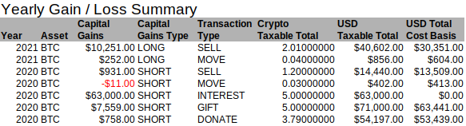
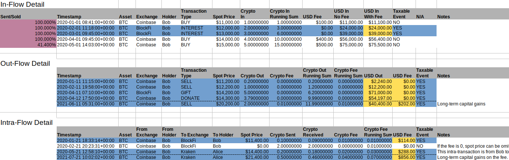
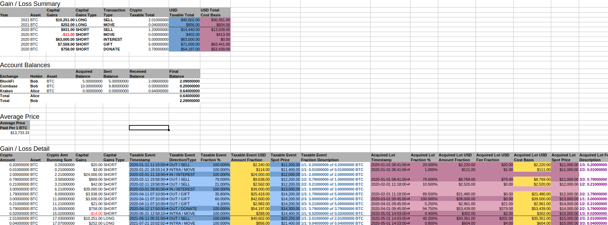
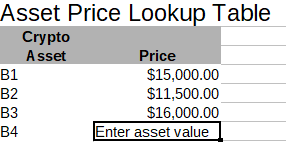
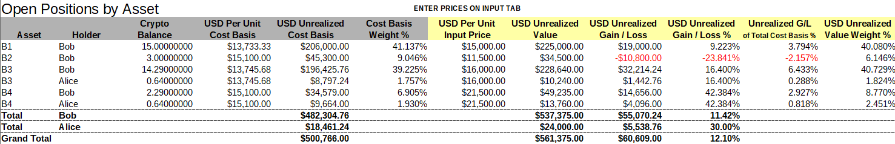
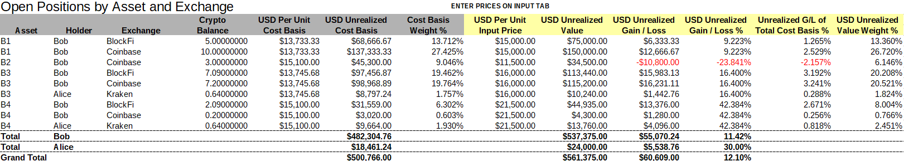
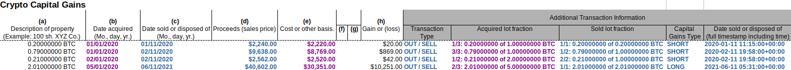
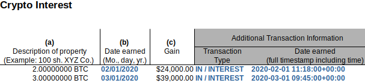

<!--- Copyright 2021 eprbell --->

<!--- Licensed under the Apache License, Version 2.0 (the "License"); --->
<!--- you may not use this file except in compliance with the License. --->
<!--- You may obtain a copy of the License at --->

<!---     http://www.apache.org/licenses/LICENSE-2.0 --->

<!--- Unless required by applicable law or agreed to in writing, software --->
<!--- distributed under the License is distributed on an "AS IS" BASIS, --->
<!--- WITHOUT WARRANTIES OR CONDITIONS OF ANY KIND, either express or implied. --->
<!--- See the License for the specific language governing permissions and --->
<!--- limitations under the License. --->

# Output Files

## Table of Contents
* **[Introduction](#introduction)**
* **[Reports Valid for Any Country](#reports-valid-for-any-country)**
  * **[RP2 Full Output Report: Transparent Computation](#rp2-full-report-transparent-computation)**
    * [Hyperlinks](#hyperlinks)
  * **[Open Positions Report: Unrealized Gains](#open-positions-report-unrealized-gains)**
  * **[Opening Allocation Report: Unused Basis at the Switch](#opening-allocation-report-unused-basis-at-the-switch)**
* **[Country-specific Reports](#country-specific-reports)**
  * **[Tax Report US: Advisor-Friendly Report](#tax-report-us-advisor-friendly-report)**
  * **[Tax Report IE: Advisor-Friendly Report](#tax-report-ie-advisor-friendly-report)**
  * **[Tax Report JP: NTA-Friendly Report](#tax-report-jp-nta-friendly-report)**

## Introduction
RP2 generates output files by running the report plugins, which vary [country by country](https://github.com/eprbell/rp2/blob/main/docs/supported_countries.md).

After running RP2, the output files can be found in the `output` directory or in the directory specified with the -o command line option. A description of the various report generators follows below.

## Reports Valid for Any Country

The following reports are valid for any country.

### RP2 Full Report: Transparent Computation
The rp2_full_report.ods output file is a comprehensive, ODS-format report containing full details about the computed taxes (which can be useful in case of audit): complete transaction history with hyperlinks, long/short capital gains, cost bases, balances, average price, in/out lot relationships and fractioning. See [crypto_example_fifo_rp2_full_report.ods](../input/golden/us/crypto_example_fifo_rp2_full_report.ods) (an example of this output for input file [crypto_example.ods](../input/crypto_example.ods)) and screenshots further down in this document.

This report makes it possible to follow step-by-step the process RP2 uses to produce results and verify them. It contains:
* a Legend sheet containing accounting method information and the meaning of each column and keyword
* a Summary sheet containing total short/long term capital gains per year, per cryptocurrency. Here follows an example of this sheet: 
* two sheets per cryptocurrency:
  * *cryptocurrency* In-Out: full transaction history for the given *cryptocurrency*, organized by direction (In, Out, Intra). Taxable events are shown in blue, with taxable amount in yellow. The *In* table has a *Sent/Sold* column showing which lots have been fully or partially sold (in purple). Timestamps are homogenized (in the user input spreadsheet they may have different formats), transactions are sorted by time and some running sums are computed. Here follows an example of this sheet: 
  * *cryptocurrency* Tax: full tax computation details for the given *cryptocurrency*: long/short capital gains, cost bases, balances, average price, in/out lot relationships and fractions. In this sheet, blue refers to taxable events and outgoing (sold, donated, etc.) transactions, purple refers to cost basis and incoming (purchased, received) transactions and yellow refers to taxable amount. The Intra-Flow Detail table shows the mapping between taxable event fractions and in-transaction fractions. Here follows an example of this sheet: 

#### Hyperlinks
The RP2 Full Report contains hyperlinks to facilitate navigation: in LibreOffice, CTRL-click (on Mac, Command-click) on a cell to jump to the target. The following content is hyperlinked:
  * taxable events and acquired lots in *cryptocurrency* Tax sheet are hyperlinked to their definition line in the *cryptocurrency* In-Out sheet. With per-wallet application, coins that came to a wallet through transfers or the opening allocation are in a lot that RP2 creates for that wallet, which has no line: the Tax sheet shows the unique id of their original lot (the input transaction they come from) and links to its line, and the lot's description adds the wallet and RP2's lot, e.g. `1/1: 1.00000000 of 2.00000000 BTC in Kraken/Bob (lot t1/-1)`. RP2's lot is named after the transfer (`t1`), or after the original lot for the opening allocation, plus a negative number that RP2 assigns in the order in which it creates lots and transactions of its own, for all assets: the number is the same in all the reports of a run, but it can change when the input changes. If a date filter (`-f`, `-t`) leaves the line out of the In-Out sheet, the cells have no link;
  * summary lines in the Summary sheet are now hyperlinked to the first line of the given year in the *cryptocurrency* Tax sheet.

### Open Positions Report: Unrealized Gains
The open_positions_\*.ods output file is an ODS-format spreadsheet designed to provide information on assets with non-zero crypto balances including gains and losses.

The report contains:
* a Legend sheet containing the accounting method and the meaning of each column and keyword
* the Input sheet for entering current asset values (or asset values on a given date to be used for the calculations per user requirements). 
* the Asset sheet which among other things shows the crypto balance, cost basis information (by unit and in whole) and portfolio weighting of each asset as well as the unrealized / market value and the gains / loss data in fiat and percentage terms in addition to further breakdowns. This tab summarizes the information by asset and holder. 
* The Asset - Exchange sheet provides the same information as the asset tab, but further breaks the information down by exchange. 

The cost basis of each exchange depends on how the asset is computed at the end of the report period (see [universal and per-wallet application](user_faq.md#do-accounting-methods-use-universal-or-per-wallet-application)):
* universal application: the asset's remaining cost basis is shared among its exchanges in proportion to their balances, so all exchanges have the same per-unit cost basis (with a from date, lots acquired before it are left out);
* per-wallet application (for assets that need it in the report period, see the [FAQ](user_faq.md#how-do-i-use-per-wallet-application)): each exchange shows the actual cost basis of the units it holds at the end of the report period (the to date), and the Asset sheet adds up the exchanges of each holder. Example: 1 unit bought for 100 on exchange A and 1 unit bought for 1,000 on exchange B: A shows 100 and B 1,000 (universal application would show 550 for each).

### Opening Allocation Report: Unused Basis at the Switch
The opening_allocation.ods output file is generated for countries that switch from universal to per-wallet application (the US, on January 1st, 2025: see the [FAQ](user_faq.md#how-do-i-use-per-wallet-application)), if the report reaches the switch (whatever the `-f` date: the allocation is the starting point of every later year) and some wallet holds units then. It shows how the cost basis of those units was assigned to the wallets with the allocation rule of the config file (for the US rules see [USA](supported_countries.md#per-wallet-application-from-2025)), as it was made at the switch: transactions after the switch don't change it. If a run has no opening allocation (e.g. the report ends before 2025), the file isn't generated, and the one of an earlier run with the same output directory and prefix is removed. If the config file has a `generators` field, add `opening_allocation` to it to get this report.

The report contains a Legend sheet (accounting method and the meaning of each column) and these sheets, with a block of rows for each asset:
* Summary: the switch instant and time zone (the `timezone` of the config file), the rule (allocation method, wallet order and the config fields they come from, e.g. `unused_basis_allocation_wallet_order.BTC` for a per-asset override; "Automatic" if only one wallet holds units, which needs no rule) and the totals that must match: the units of the unused lots, of the allocated pieces and of the wallets at the switch, and the cost basis of the unused lots and of the allocated pieces;
* Wallets: the units each wallet held at the switch (its opening balance, computed from the transactions before it) and the units, cost basis and number of pieces it received. Wallets in the order that held nothing receive nothing;
* Unused Lots: the lots that universal application hadn't disposed of at the switch, in the order of the allocation method: unique_id and row in the input, acquisition date, wallet where they were acquired, spot price, units, unused units, per-unit cost basis and unused cost basis;
* Allocation: one row for each piece of an unused lot assigned to a wallet: the wallet, the source lot (unique_id, input row and acquisition date), units, per-unit cost basis and cost basis.

Example: in 2024 buy 10 coins for $100 each on Coinbase (lot i1) and 10 for $200 each on Kraken (lot i2), then move 5 coins from Coinbase to Kraken. At the switch Coinbase holds 5 coins and Kraken 15. With FIFO and the wallet order Kraken, Coinbase, the Allocation sheet has three rows: Kraken gets 10 coins of i1 ($1,000) and 5 coins of i2 ($1,000), and Coinbase the other 5 coins of i2 ($1,000).

## Country-specific Reports

The following reports are country-specific.

### Tax Report US: Advisor-Friendly Report
This is a US-specific tax-advisor-friendly report that can be understood by tax professionals (not necessarily specializing in crypto). It can be used to fill form 8949, etc: see [crypto_example_fifo_tax_report_us.ods](../input/golden/us/crypto_example_fifo_tax_report_us.ods) (an example of this output for input file [crypto_example.ods](../input/crypto_example.ods)) and screenshots further down.

The tax_report_us.ods output file contains a legend sheet and a sheet per taxable event type (if there are no taxable events for a given event type, its respective sheet is not generated):
* Airdrops;
* Capital Gains (triggered by cryptocurrency sales);
* Donations (cryptocurrency given to a qualified charity);
* Gifts (cryptocurrency gifted to a friends or family);
* Hard Forks;
* Income;
* Interest;
* Investment Expenses (cryptocurrency fee paid when moving funds between two accounts owned by the same person);
* Mining;
* Staking;
* Wages.

These sheets are in the format of form 8949 and are meant for tax preparers, who can use it to fill the appropriate forms. Every line corresponds to a taxable event and describes it. The left part (with white header) mimics form 8949: cost basis, capital gains, proceeds, etc. The right part (with gray header) contains additional information that can be used to identify the transactions in the user's records or in the [rp2_full_report output](#rp2-full-report-transparent-computation): full timestamp of date sold, capital gains type (long or short), lot fraction information, transaction type, unique_id, etc. The unique_id of a lot is the one of its original lot, as in the [rp2_full_report output](#hyperlinks). In this sheet blue refers to taxable events and purple to in-transactions (purchased, earned, etc.).

Each sheet has a [specific tax treatment](https://github.com/eprbell/rp2/blob/main/docs/user_faq.md#which-crypto-tax-forms-to-file).

Here follows an example of the Capital Gains sheet:

And an example of the Interest sheet:

### Tax Report IE: Advisor-Friendly Report
This is a Ireland-specific tax-advisor-friendly report that can be understood by tax professionals (not necessarily specializing in crypto). It follows the same format as the [US variant](#tax-report-us-advisor-friendly-report).

### Tax Report JP: NTA-friendly Report
This is a Japan-specific report: tax_report_jp.ods output file contains a legend sheet, a summary sheet for every year, and a calculation sheet per asset and year.

The NTA (National Tax Agency) provides an excel spreadsheet for calculating the total average of each crypto asset per year. This report generates a similar report and can be optionally submitted with an individual's taxes or provided to the NTA if requested.

The summary sheet contains the total for the tax year. This is what is normally reported as "miscellaneous income" (雑所得). However, it may be reported as business income in certain circumstances. Please do your own research.
